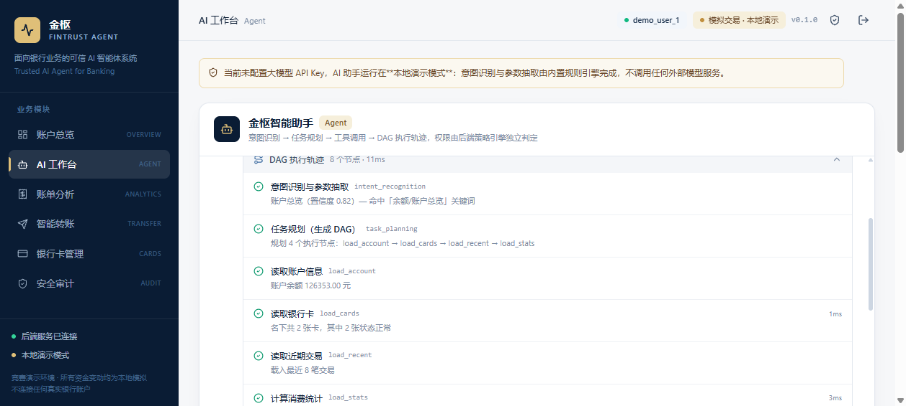
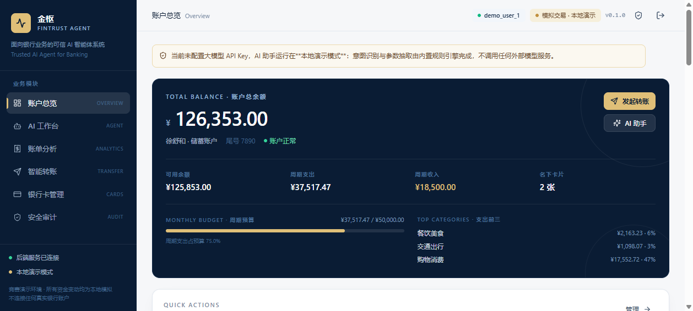
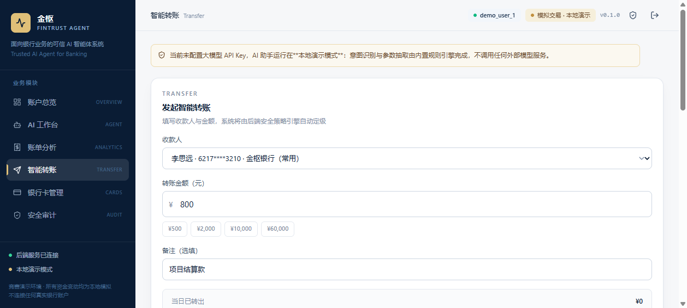
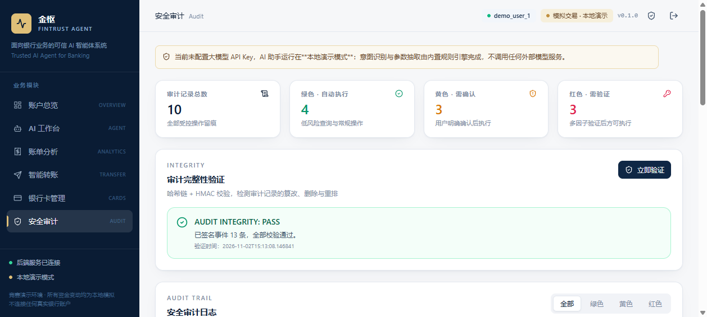
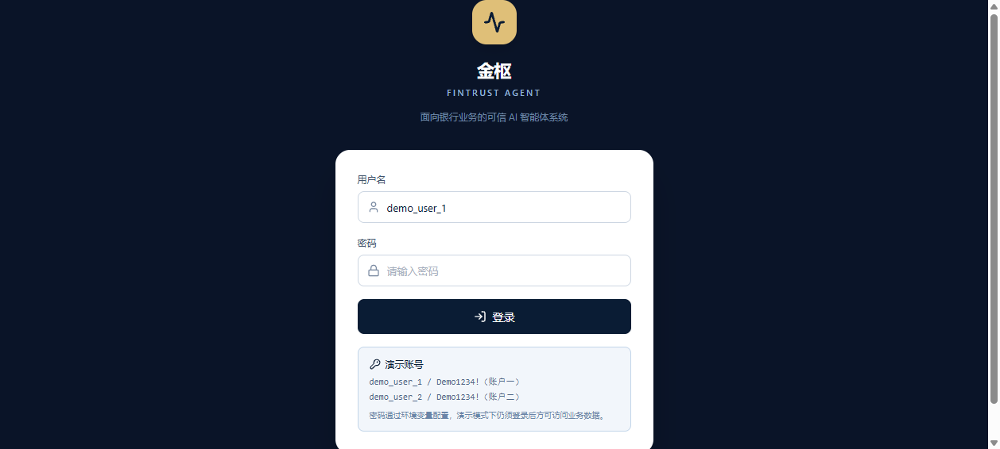

# 金枢 FinTrust Agent

> 面向银行业务的**可信 AI 智能体系统** —— 自然语言驱动的智能转账、智能账单分析与智能银行卡管理，
> 全流程由**独立的后端权限策略引擎**（绿 / 黄 / 红三级）强制管控。

竞赛 MVP · 前后端完整可运行 · 所有资金变动均为本地模拟，不连接任何真实银行账户。

---

## 系统实拍

以下截图均为**本地真实运行的前后端系统**采集，未做任何伪造或美化修饰。

**AI 工作台 — DAG 规划与执行轨迹展开**



**账户总览**



**智能转账 — 三级权限策略与日累计**



**审计完整性验证 — 哈希链校验 PASS**



**登录页**



---

## 目录

- [核心特性](#核心特性)
- [系统实拍](#系统实拍)
- [技术栈](#技术栈)
- [快速开始](#快速开始)
- [项目结构](#项目结构)
- [三大业务场景](#三大业务场景)
- [三级安全机制](#三级安全机制)
- [Agent 执行链路](#agent-执行链路)
- [环境变量说明](#环境变量说明)
- [数据库与初始化脚本](#数据库与初始化脚本)
- [测试](#测试)
- [竞赛交付材料](#竞赛交付材料)
- [文档索引](#文档索引)
- [重要声明](#重要声明)

---

## 核心特性

| 能力 | 说明 |
| --- | --- |
| 🧠 **Agent 引擎** | 意图识别 → 结构化参数抽取 → 任务规划（DAG）→ 工具调用 → DAG 执行轨迹 |
| 🔐 **独立权限引擎** | 权限判定完全在服务端，**大模型无法决定自身权限范围** |
| 🟢🟡🔴 **三级权限** | 绿色自动执行 / 黄色需用户确认 / 红色需模拟多因子验证 |
| 👤 **身份认证** | 登录 / 会话 / 账户归属校验，跨账户访问返回 403 |
| 🔁 **幂等控制** | 写操作强制 `Idempotency-Key`，重复提交不重复扣款 |
| ⚡ **异常熔断** | 模型服务连续失败自动熔断，降级到本地规则引擎 |
| 📋 **全量审计** | 预览 / 放行 / 需确认 / 需验证 / 拦截 + 状态迁移，全部只追加留痕 |
| 🔢 **七状态交易机** | PENDING_CONFIRMATION / PENDING_MFA / EXECUTING / SUCCEEDED / FAILED / CANCELLED / EXPIRED |
| 🔑 **MFA 持久化** | 验证码 HMAC 摘要落库，跨重启可验证，一次性消费 |
| 📊 **账单智能分析** | 消费分类、月度统计、异常交易识别（规则引擎 + 基线对比） |
| 💳 **卡片全生命周期** | 卡片查询、虚拟卡申请、冻结/解冻、挂失模拟 |
| 🧪 **开箱可演示** | 未配置模型 Key 时自动进入**本地演示模式**，功能完整可用 |

---

## 技术栈

**前端** — React 18 · TypeScript 5 · Vite 6 · Tailwind CSS 3 · Lucide Icons · React Router 6
**后端** — Python 3.11+ · FastAPI · SQLAlchemy 2.0 · SQLite · Pydantic v2
**AI** — OpenAI 兼容接口（可配置任意 base_url）+ 本地规则引擎双通道
**安全** — 独立策略引擎 · 模拟 MFA · 幂等键 · 熔断器 · 只追加审计日志

---

## 快速开始

### 环境要求

- Node.js ≥ 18（实测 22.22.2）
- Python ≥ 3.11（实测 3.13.14）

### 1️⃣ 启动后端

```bash
cd backend

# 创建虚拟环境（Windows）
python -m venv .venv
.venv/Scripts/python.exe -m pip install -r requirements.txt

# macOS / Linux
# python3 -m venv .venv
# source .venv/bin/activate && pip install -r requirements.txt

# 初始化数据库并写入演示数据（仅首次全新安装时使用）
.venv/Scripts/python.exe scripts/init_db.py --recreate

# 【已有项目升级】执行安全迁移（不重置余额与流水）
.venv/Scripts/python.exe scripts/migrate_v030.py

# 启动（默认 http://127.0.0.1:8000）
.venv/Scripts/python.exe -m uvicorn app.main:app --reload --port 8000
```

后端启动后可访问：
- API 文档：<http://127.0.0.1:8000/docs>
- 健康检查：<http://127.0.0.1:8000/api/v1/health>

### 2️⃣ 启动前端

```bash
cd frontend
npm install
npm run dev
```

访问 <http://127.0.0.1:5173> 即可。

### 登录

系统已启用身份认证，启动后访问前端会先进入登录页。演示账号：

| 用户名 | 密码 | 绑定账户 |
| --- | --- | --- |
| `demo_user_1` | `Demo1234!` | 账户一（徐舒和 储蓄卡） |
| `demo_user_2` | `Demo1234!` | 账户二（徐舒和 信用卡） |

> 演示账号密码通过环境变量 `DEMO_USER_1_PASSWORD` / `DEMO_USER_2_PASSWORD` 配置，勿在生产环境使用默认值。
> 即使在演示模式下也必须登录后才能访问业务数据；跨账户访问会返回 403。

> 前端通过 Vite Proxy 将 `/api` 转发到 `http://127.0.0.1:8000`，无需额外配置跨域。

### 3️⃣ 一键脚本（可选）

```bash
# Windows
start_backend.bat      # 启动后端
start_frontend.bat     # 启动前端
```

### 启用真实大模型（可选）

复制 `backend/.env.example` 为 `backend/.env`，填写：

```ini
LLM_BASE_URL=https://api.openai.com/v1
LLM_API_KEY=sk-xxxxxxxxxxxxxxxx
LLM_MODEL=gpt-4o-mini
```

重启后端即可。未配置时系统运行在**本地演示模式**，界面顶部会明确标注。

---

## 项目结构

```
jingshu/
├── backend/                        # FastAPI 后端
│   ├── app/
│   │   ├── main.py                 # 应用入口（CORS / 统一异常 / TraceId）
│   │   ├── core/
│   │   │   ├── config.py           # pydantic-settings 配置（含密钥隔离）
│   │   │   ├── database.py         # SQLAlchemy 引擎 / 会话 / WAL
│   │   │   └── errors.py           # 统一错误响应格式
│   │   ├── models/                 # ORM 数据模型
│   │   │   └── __init__.py         # Account/Card/Transaction/Payee/AuditLog/
│   │   │                           # AgentSession/AgentMessage/TransferOrder/IdempotencyRecord
│   │   │                           # User/UserAccount/Session/MfaChallenge/
│   │   │                           # OrderStatusTransition/RateLimitRecord
│   │   ├── schemas/                # Pydantic 请求 / 响应模型
│   │   ├── security/               # ★ 安全层（与业务、模型完全解耦）
│   │   │   ├── policy.py           #   三级权限策略引擎
│   │   │   ├── order_state.py      #   七状态交易状态机 + 迁移审计
│   │   │   ├── password.py         #   PBKDF2 密码哈希 + Token 哈希
│   │   │   ├── mfa.py              #   持久化多因子验证（HMAC 摘要）
│   │   │   ├── rate_limiter.py     #   统一请求限流
│   │   │   ├── idempotency.py      #   幂等控制
│   │   │   ├── circuit_breaker.py  #   异常熔断
│   │   │   ├── audit.py            #   审计写入
│   │   │   └── audit_integrity.py  #   审计哈希链签名与验证
│   │   ├── services/               # 业务服务
│   │   │   ├── account_service.py
│   │   │   ├── analytics_service.py  # 分类 / 月度 / 异常识别
│   │   │   ├── transfer_service.py   # 转账执行链路（七状态机）
│   │   │   ├── auth_service.py       # 认证 / 会话 / 账户归属
│   │   │   ├── password_service.py   # 密码修改
│   │   │   └── card_service.py
│   │   ├── agent/                  # ★ Agent 引擎
│   │   │   ├── llm.py              #   OpenAI 兼容客户端 + 熔断
│   │   │   ├── nlu.py              #   意图识别 + 参数抽取（LLM 优先 / 规则降级）
│   │   │   ├── planner.py          #   DAG 任务规划
│   │   │   ├── tools.py            #   工具白名单注册表 + 安全元数据
│   │   │   └── orchestrator.py     #   编排器 + 执行轨迹 + 安全约束
│   │   └── api/routes/             # REST 路由（auth / accounts / transactions /
│   │                               #   payees / transfers / cards / agent / audit）
│   ├── scripts/
│   │   ├── init_db.py              # 建表 + 种子数据
│   │   ├── migrate_v030.py         # 迁移：认证 + 七状态交易机
│   │   ├── migrate_v040.py         # 迁移：审计哈希链 + 防篡改触发器 + 限流表
│   │   ├── prepare_demo.py         # 演示前准备（重置当日累计 + 检查清单）
│   │   ├── verify_audit_integrity.py  # 审计完整性验证工具
│   │   └── smoke_api.py            # 全接口冒烟测试
│   ├── tests/                      # pytest 用例（117 个）
│   ├── data/fintrust.db            # SQLite 数据库（开发库，勿重置）
│   ├── requirements.txt
│   └── .env.example
│
├── frontend/                       # React + TS + Vite
│   ├── src/
│   │   ├── api/                    # 统一 API 客户端（Bearer 注入 + 401 处理）
│   │   ├── components/ui/          # 设计系统组件（primitives / charts）
│   │   ├── components/SecuritySettings.tsx  # 安全设置（密码修改）
│   │   ├── context/AccountContext.tsx       # 账户上下文（双账户切换）
│   │   ├── layouts/AppShell.tsx    # 侧边栏 + 顶栏（账户切换 / 登出）
│   │   ├── pages/                  # 六大业务页面 + 登录页
│   │   ├── hooks/                  # useAsync / useOverview
│   │   ├── styles/index.css        # 统一设计系统（深海军蓝 / 白 / 香槟金）
│   │   └── types/                  # 与后端 schema 对齐的类型
│   ├── tailwind.config.js
│   ├── vite.config.ts
│   └── package.json
│
├── docs/
│   ├── ARCHITECTURE.md             # 系统架构说明
│   ├── SECURITY.md                 # 安全设计说明
│   ├── DEPLOYMENT.md               # 本地部署说明
│   ├── API.md                      # 接口清单
│   ├── screenshots/                # 真实系统截图（由本地运行采集，未伪造）
│   │   ├── 01_login.png
│   │   ├── 02_dashboard.png
│   │   ├── 03_agent_dag_expanded.png
│   │   ├── 04_transfer_yellow.png
│   │   ├── 04_transfer_yellow_full.png
│   │   └── 05_audit_pass.png
│   └── FINAL_*.md                  # 验收 / 安全审计 / 测试报告 / 已知限制等
│
├── submission/                     # 竞赛必交材料
│   ├── 01_金枢技术设计说明书.pdf
│   ├── 02_金枢答辩PPT.pptx
│   ├── 03_金枢完整源代码.zip
│   ├── 04_金枢安全自评报告.pdf
│   └── build/                      # 上述四份材料的可复现生成脚本
│       ├── build_pdfs.py           #   生成 01 / 04（ReportLab）
│       ├── build_pptx.js           #   生成 02（pptxgenjs）
│       ├── package_source.py       #   生成 03 并执行敏感信息审计
│       └── zip_validation.json     #   上一次源码包校验报告
└── README.md
```

---

## 三大业务场景

### ① 智能转账

自然语言输入 → 抽取收款人 / 金额 / 备注 → 查当日累计 → 策略引擎定级 → 按等级执行。

```
用户：给张明远转 800 元，备注项目结算款
Agent：已为你生成转账方案（黄色 · 需确认）
      - 收款人：张明远（6212****7890）
      - 金额：¥ 800.00
      - 备注：项目结算款
      - 当日累计：¥ 800.00（未超 ¥1,000 黄线）
      - 工单号：TR2026...
```

**涉及真实后端逻辑**：收款人匹配 → 当日累计查询 → 策略引擎定级 → 工单落库 → 余额校验 → 扣款 → 生成流水 → 写审计日志。

### ② 智能账单分析

- **消费分类**：22 类消费场景，按金额降序 + 占比
- **月度统计**：近 6 个自然月收支趋势（当月进行中以虚线 + "至今"标注）
- **异常交易识别**：三条规则 —— 超出分类基线 3 倍且 >¥1000、凌晨 0:00–5:00 非常规时段、夜间高额（≥¥8000）
- **自然语言查询**：支持「本月/上月/近七天」「餐饮/交通/购物…」「收入/支出」等条件解析

### ③ 智能银行卡管理

- 卡片列表与状态（正常 / 已冻结 / 已挂失）
- 虚拟卡申请（**黄色**：需明确确认后签发）
- 卡片冻结 / 解冻（**黄色**：需明确确认）
- 银行卡挂失（**红色**：强制模拟多因子验证）

---

## 三级安全机制

| 等级 | 触发条件 | 系统行为 | HTTP 状态 |
| --- | --- | --- | --- |
| 🟢 **绿色** | 余额查询、交易查询、账单分析、理财收益查询等**纯只读**操作 | 自动执行 + 写审计 | `200` |
| 🟡 **黄色** | 写操作中的普通小额转账，**执行后当日累计 ≤ ¥1,000**；虚拟卡申请；卡片冻结 | 返回 `409 CONFIRMATION_REQUIRED`，展示完整明细等待用户确认 | `409` → `200` |
| 🔴 **红色** | **执行后当日累计 > ¥1,000**；银行卡挂失；密码修改；备注命中敏感词；单笔 ≥ ¥10,000（辅助升红） | 返回 `428 MFA_REQUIRED` 并下发模拟验证码，验证通过才执行 | `428` → `200` |
| ⛔ **阻断** | 当日累计 > ¥100,000 | 直接拦截，不可执行 | `403 POLICY_BLOCKED` |

> **关键约束**：
> - 任何**资金写操作绝不获得绿色权限**（写操作最低黄色）。
> - **日累计金额是主要判定依据**（≤¥1,000 黄，>¥1,000 红），单笔金额仅作辅助升红因子。
> - 策略引擎只接收**业务事实**（金额、当日累计、是否常用收款人、是否敏感操作），**不接受任何来自大模型的权限建议**。

---

## Agent 执行链路

```
用户输入
   │
   ├─ ① 意图识别与参数抽取   nlu.py         规则引擎 +（可选）LLM 增强
   │                          └ 失败自动回退本地规则
   ├─ ② 任务规划             planner.py     生成带依赖关系的 DAG
   ├─ ③ 工具调用             tools.py       调用真实业务服务
   ├─ ④ 权限判定             policy.py      ★ 后端独立执行，与模型无关
   ├─ ⑤ 答复生成与轨迹留痕   orchestrator.py 写入 Agent 消息 + 审计日志
   │
   └─► 返回：答复文本 + DAG 执行轨迹（每个节点的耗时 / 状态 / 详情）
```

DAG 轨迹在前端可展开查看，完整展示「意图识别 → 任务规划 → resolve_payee → check_daily_total →
evaluate_policy → prepare_order → 答复生成」每一个节点。

---

## 环境变量说明

完整清单见 [`backend/.env.example`](backend/.env.example)，关键项：

| 变量 | 默认值 | 说明 |
| --- | --- | --- |
| `LLM_API_KEY` | *(空)* | **仅存在于后端环境变量**，绝不下发前端；为空即进入本地演示模式 |
| `LLM_BASE_URL` | `https://api.openai.com/v1` | 任意 OpenAI 兼容服务地址 |
| `LLM_MODEL` | `gpt-4o-mini` | 模型名 |
| `DATABASE_URL` | `sqlite:///./data/fintrust.db` | SQLite 路径 |
| `CORS_ORIGINS` | `http://localhost:5173` | 允许的前端来源 |
| `POLICY_YELLOW_DAILY_MAX` | `1000` | 日累计 ≤ 此值 → 黄色（写操作） |
| `POLICY_RED_DAILY_MIN` | `1000` | 日累计 > 此值 → 红色（需 MFA） |
| `POLICY_RED_SINGLE_MIN` | `10000` | 单笔辅助升红阈值（元） |
| `POLICY_RED_DAILY_TOTAL` | `100000` | 风控硬红线（阻断） |
| `SESSION_TTL_MINUTES` | `720` | 会话有效期（分钟） |
| `TRANSFER_ORDER_TTL_MINUTES` | `15` | 转账工单过期时间（分钟） |
| `MFA_TTL_SECONDS` | `300` | MFA 挑战有效期（秒） |
| `MFA_MAX_ATTEMPTS` | `5` | MFA 最大错误尝试次数 |
| `MFA_SECRET_KEY` | *(空)* | MFA 验证码 HMAC 密钥 |
| `AUTH_SESSION_SECRET` | *(空)* | 会话 token 哈希盐 |
| `DEMO_USER_1_PASSWORD` / `DEMO_USER_2_PASSWORD` | `Demo1234!` | 演示账号密码 |
| `BUSINESS_TIMEZONE` | `Asia/Shanghai` | 业务时区 |
| `CIRCUIT_BREAKER_THRESHOLD` | `5` | 熔断触发的连续失败次数 |
| `FORCE_DEMO_MODE` | `false` | 强制本地演示模式（忽略 API Key） |

前端仅有一个可选变量 `VITE_API_BASE_URL`（默认 `/api/v1`，走 Vite 代理）。

---

## 数据库与初始化脚本

```bash
cd backend
.venv/Scripts/python.exe scripts/init_db.py --help

# 常用命令
python scripts/init_db.py              # 建表（已有数据则跳过灌数）
python scripts/init_db.py --recreate   # ⚠️ 破坏性：删除并重建全部表，仅用于全新安装
python scripts/init_db.py --reset      # ⚠️ 破坏性：清空业务表后重新灌入种子数据
python scripts/init_db.py --no-seed    # 仅建表，不写入演示数据

# 已有数据库升级（不重置任何数据）
python scripts/migrate_v030.py         # 身份认证 + 七状态交易机
python scripts/migrate_v040.py         # 审计哈希链 + 防篡改触发器 + 限流表

# 演示前准备（重置演示库当日累计 + 输出检查清单）
DATABASE_URL="sqlite:///./data/demo_v100.db" \
  python scripts/prepare_demo.py --reset-daily

# 审计完整性验证
python scripts/verify_audit_integrity.py
```

> ⚠️ **`--recreate` / `--reset` 是破坏性操作，会清空账户余额与交易流水。**
> 已有数据的环境请使用 `migrate_v030.py` / `migrate_v040.py` 迁移脚本，它们不删表、不重置数据。

**数据模型（15 张表）**

| 表 | 说明 |
| --- | --- |
| `accounts` | 银行账户（余额以**整数分**存储，杜绝浮点误差） |
| `cards` | 银行卡（含虚拟卡） |
| `transactions` | 交易流水（全部带 `is_simulated` 标记） |
| `payees` | 收款人 |
| `audit_logs` | 安全审计日志（只追加 + 哈希链签名） |
| `agent_sessions` / `agent_messages` | Agent 会话与消息（含 DAG 轨迹 JSON） |
| `transfer_orders` | 转账工单（七状态 + 时间戳 + 权限快照） |
| `idempotency_records` | 幂等控制记录 |
| `users` / `user_accounts` / `sessions` | 身份认证与账户授权 |
| `mfa_challenges` | 持久化 MFA 挑战（验证码存 HMAC 摘要） |
| `order_status_transitions` | 交易状态迁移审计（只追加） |
| `rate_limit_records` | 请求限流窗口计数 |
| `order_status_transitions` | 交易状态迁移审计（只追加） |

### 七状态交易流程

```
预览 → PENDING_CONFIRMATION（待确认）
      → 用户确认 → EXECUTING → SUCCEEDED / FAILED
      → 风险升级 → PENDING_MFA（待验证）→ EXECUTING → SUCCEEDED / FAILED
      → 主动取消 → CANCELLED
      → 超时（默认 15 分钟）→ EXPIRED

终态（SUCCEEDED/FAILED/CANCELLED/EXPIRED）不可再执行或取消。
```

---

## 测试

```bash
cd backend

# 单元 + 集成测试（117 个用例）
.venv/Scripts/python.exe -m pytest tests/ -q

# 查看实际用例总数
.venv/Scripts/python.exe -m pytest --collect-only

# 覆盖率测量（区分行覆盖与分支覆盖）
.venv/Scripts/python.exe -m pytest --cov=app --cov-branch --cov-report=term -q

# 全接口冒烟（40+ 项，需后端已启动）
.venv/Scripts/python.exe scripts/smoke_api.py
```

覆盖范围：
- **策略引擎**：绿/黄/红定级、日累计升级、红线阻断、敏感词升级、非白名单动作拦截
- **意图识别**：11 类意图、中文数字金额解析、卡号误识别规避、备注抽取
- **身份认证**：登录/登出/me、错误密码、跨账户 403、数据隔离、Agent 越权
- **七状态机**：合法/非法迁移、取消、过期、失败落库、迁移审计
- **MFA 持久化**：挑战落库、一次性消费、跨交易复用拒绝、错误锁定、过期拒绝
- **密码修改**：全流程、错误旧密码、弱密码、旧会话失效
- **并发/幂等**：20 线程并发不穿透日累计、同键幂等
- **请求限流**：登录/MFA/Agent/转账/审计限流、429 + Retry-After
- **Agent 安全**：提示词注入、恶意数据、伪造权限/身份、未知工具、DAG 约束
- **审计完整性**：哈希链验证、篡改/删除/重排检测、防篡改触发器
- **接口冒烟**：40+ 项，逐一验证前端实际调用的每一个后端接口

> **测试口径**：用例总数以 `pytest --collect-only` 实际输出为准（当前 **117**）。
> 各阶段报告（`P0_*` / `P1_*`）中的数字为该阶段的历史快照，顶部已加口径说明。

前端校验：

```bash
cd frontend
npx tsc --noEmit      # 类型检查
npm run build         # 生产构建
```

---

## 竞赛交付材料

四份必交材料位于 `submission/`，均由本仓库源码生成，内容以实际实现为事实依据：

| 材料 | 文件 | 说明 |
| --- | --- | --- |
| 技术设计说明书 | [`submission/01_金枢技术设计说明书.pdf`](submission/) | 15 页，含架构图 / 流程图 / 状态机 / 数据表 / API / 部署 / 测试结果与技术局限 |
| 答辩 PPT | [`submission/02_金枢答辩PPT.pptx`](submission/) | 10 页、10 分钟以内，含系统架构图、安全信任边界图与真实系统截图，每页配演讲备注 |
| 完整源代码包 | [`submission/03_金枢完整源代码.zip`](submission/) | 124 个文件的独立部署包，已剔除 `.env`、密钥、数据库、虚拟环境与缓存 |
| 安全自评报告 | [`submission/04_金枢安全自评报告.pdf`](submission/) | 9 页，含威胁模型、三级权限、MFA、幂等并发、注入防御、限流熔断、审计哈希链与残余风险 |

生成脚本见 [`submission/tools/`](submission/tools/)，可在本仓库根目录直接复现上述全部四份材料。

---

## 文档索引

| 文档 | 内容 |
| --- | --- |
| [`docs/ARCHITECTURE.md`](docs/ARCHITECTURE.md) | 分层架构、模块依赖、数据流、Agent DAG、数据库设计 |
| [`docs/SECURITY.md`](docs/SECURITY.md) | 三级权限模型、威胁建模、防护矩阵、审计与合规 |
| [`docs/DEPLOYMENT.md`](docs/DEPLOYMENT.md) | 环境准备、启动脚本、常见问题排查、演示脚本 |
| [`docs/API.md`](docs/API.md) | 全部 REST 接口清单与示例 |
| [`docs/P1_ARCHITECTURE_REPORT.md`](docs/P1_ARCHITECTURE_REPORT.md) | V0.3.0 认证/状态机/MFA 架构 |
| [`docs/P1_SECURITY_REPORT.md`](docs/P1_SECURITY_REPORT.md) | V0.3.0 安全设计与已知风险 |
| [`docs/P1_TEST_REPORT.md`](docs/P1_TEST_REPORT.md) | V0.3.0 测试结果与覆盖率 |
| [`docs/P1_CHANGELOG.md`](docs/P1_CHANGELOG.md) | V0.3.0 变更记录与兼容性 |
| [`docs/AGENT_THREAT_MODEL.md`](docs/AGENT_THREAT_MODEL.md) | Agent 威胁模型与安全边界 |
| [`docs/PROJECT_INTRO_200.md`](docs/PROJECT_INTRO_200.md) | ✅ 作品简介（200 字） |
| [`docs/PPT_OUTLINE_10MIN.md`](docs/PPT_OUTLINE_10MIN.md) | ✅ 答辩 PPT 逐页内容与讲解稿 |
| [`docs/FINAL_DEMO_SCRIPT_5MIN.md`](docs/FINAL_DEMO_SCRIPT_5MIN.md) | ✅ 五分钟演示脚本 |
| [`docs/FINAL_RELEASE_REPORT.md`](docs/FINAL_RELEASE_REPORT.md) | ✅ 最终发布报告 |
| [`docs/FINAL_ACCEPTANCE_REPORT.md`](docs/FINAL_ACCEPTANCE_REPORT.md) | 最终验收报告 |
| [`docs/FINAL_SECURITY_AUDIT.md`](docs/FINAL_SECURITY_AUDIT.md) | 最终安全审计报告 |
| [`docs/FINAL_AGENT_CAPABILITY_REPORT.md`](docs/FINAL_AGENT_CAPABILITY_REPORT.md) | Agent 能力报告 |
| [`docs/FINAL_TEST_REPORT.md`](docs/FINAL_TEST_REPORT.md) | 最终测试报告 |
| [`docs/FINAL_KNOWN_LIMITATIONS.md`](docs/FINAL_KNOWN_LIMITATIONS.md) | ⚠️ 已知限制清单 |
| [`docs/FINAL_SUBMISSION_CHECKLIST.md`](docs/FINAL_SUBMISSION_CHECKLIST.md) | 提交清单 |

---

## 重要声明

1. **全部为模拟交易。** 系统中的账户、余额、卡片、收款人与交易流水全部是本地生成的演示数据，
   每条流水都带 `is_simulated=true` 标记，界面上以「模拟交易」明确标注。
2. **不连接任何真实银行账户**，不执行任何真实资金交易，不对接任何支付通道。
3. **不伪造交易成功结果。** 每一次"转账成功"都真实完成了：策略判定 → 余额校验 → 扣款 → 落库流水 → 写审计日志。
   余额不足、累计超限、验证码错误等情况都会返回明确的失败原因，绝不会假装成功。
4. **模型 API Key 仅存在于后端环境变量**，不出现在前端代码、不出现在任何响应体中。
5. **权限判定不由模型决定。** 前端隐藏按钮不是安全手段 —— 即便直接调用 API，服务端策略引擎依然会拦截。

---

<div align="center">

**金枢 FinTrust Agent** · 面向银行业务的可信 AI 智能体系统

`[ 意图识别 ] → [ 任务规划 ] → [ 工具调用 ] → [ 权限判定 ] → [ 执行留痕 ]`

</div>
